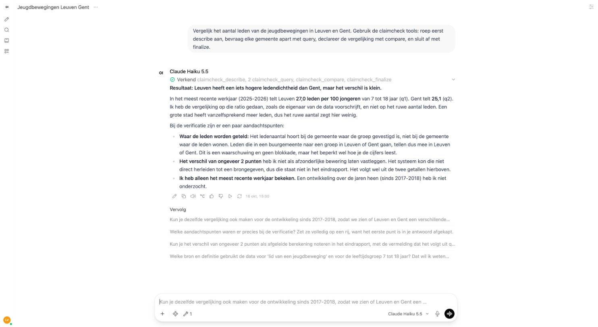

# 004 OpenWebUI

Status: draft · 2026-10-16 · uses [002-specification](002-specification.md) section 9

The MCP server exposes the five tools of one session. OpenWebUI is the first chat client; any
client that speaks MCP works the same way. The host's own search and the host's own writing
are what make the scenario's fifth and sixth questions work here: claimcheck brings neither.

## Start the server

```bash
uv run claimcheck serve --arm C --port 8765
```

One process, one dataset, one session; the arm is chosen at start-up (`A`: semantic model only,
`B`: plus the conditions as prose, `C`: plus the checker). Without `--port` the server speaks
MCP over stdio; with it, streamable HTTP on all interfaces at `/mcp`, which is what a chat
client in a container needs.

## Point OpenWebUI at it

Tested with OpenWebUI 0.12 running in Docker on the same machine.

1. *Beheerdersinstellingen → Integraties → Externe gereedschapsservers → +*.
2. Type *MCP (Streamable HTTP)*, name `claimcheck`, URL
   `http://host.docker.internal:8765/mcp`, authentication *Geen*. *Controleer verbinding*
   answers "Connectie succesvol". Save the connection, then save the page.
3. In a chat, open *Integraties* in the input bar, *Gereedschappen*, and switch `claimcheck` on.

Give the model the analyst's instructions from `src/claimcheck/prompts/analyst.md` as its
system prompt, or say in the question itself to call `describe` first, to query one place per
comparison, to declare the comparison with `compare` and to close with `finalize`.

## What to expect



Above: Claude Haiku 5.5 in OpenWebUI, with the claimcheck tools on. It called `describe`, two
`query` calls (one per gemeente), `compare` and `finalize`, answered on leden per 100 jongeren
rather than on the raw count, and carried the owner's sentence that the gemeente is the
gemeente of the group, not of the member.

- `describe` returns the scope, the measures, the dimensions with their values and, in arms B
  and C, the owner's sentences.
- `query` returns rows, or a refusal with the sentence and an alternative, or an error naming
  what the data does not hold; the gap is recorded on the session.
- `compare` records a comparison and returns the verdicts on it.
- `finalize` closes a question with its finding; pass the question text, since the host does not
  call `ask`. The finding separates what the data says from what the model says and lists the
  gaps and the verdicts.
- `check_draft` takes the text the host wrote and says which numbers trace to a data statement
  of a finding in this session, and whether the text is marked as a concept and lists sources.

The server reads `model/` and `data/` relative to the repository, so run it from a checkout.
